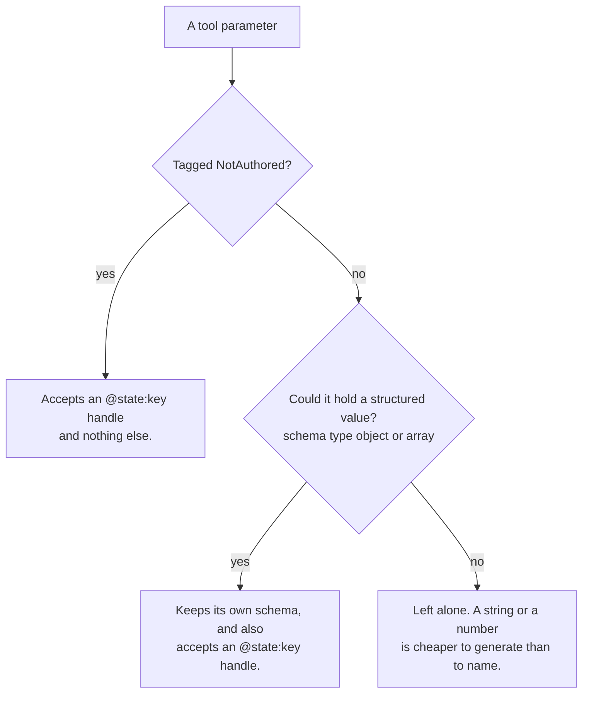
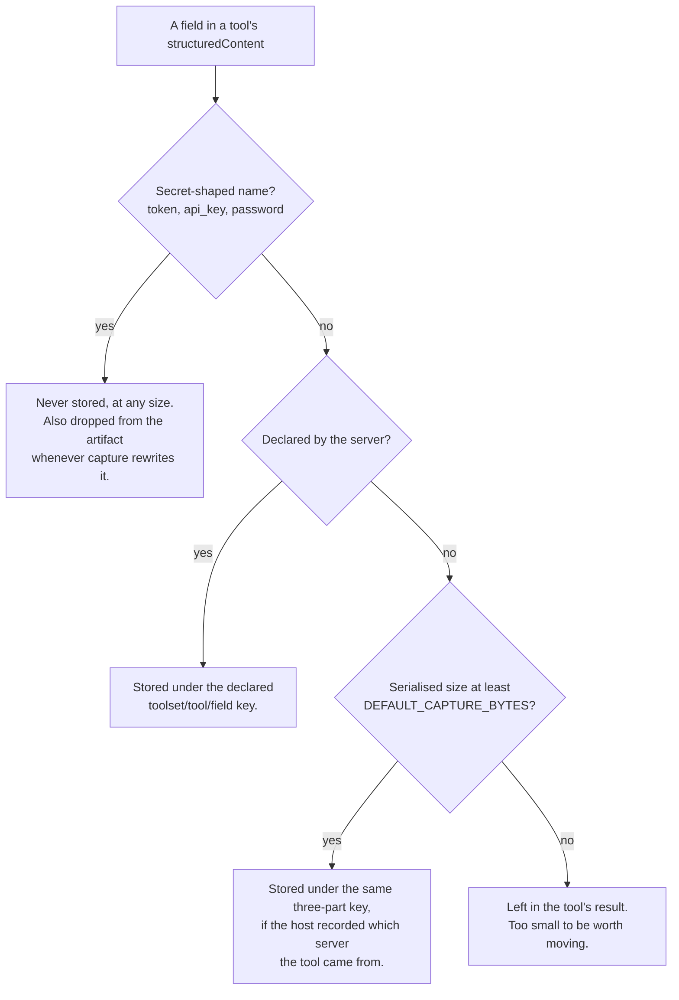
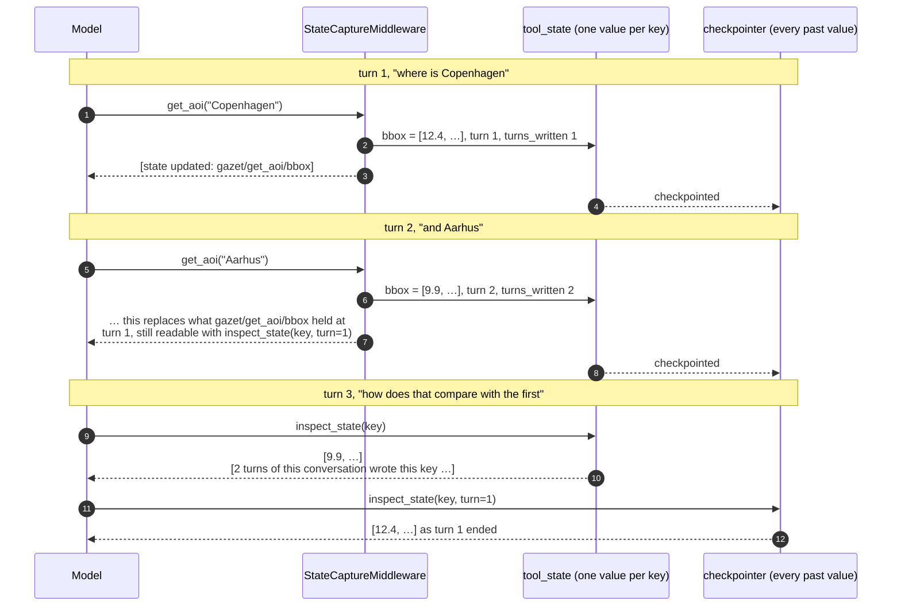

# Session state: what the model never sees

Some tool inputs and outputs are too large for the model to handle: a clip
geometry, an item collection, a raster footprint. Asking a model to produce one
spends tokens on a value it can only copy imperfectly. Letting one back into
the transcript spends tokens on every turn after it.

`mcp_state` moves such a value from the tool that produced it to the tool that
needs it. It travels through agent state and never passes through the model.

## The promise

**A large value is stored once, named cheaply, and never re-enters the
conversation.** The model is told that a value exists and what produced it. It
decides which value a call should use. The client puts the payload in on the
way to the server.

Three things follow from "the model decides".

1. **The model must be able to say what it wants, cheaply.** Every parameter
   that could hold a structured value accepts a second form: a **handle**, a
   string naming something already stored, such as
   `"@state:dataset-search/search_datasets/area_of_interest"`. That is about
   ten tokens instead of 38 kB.
2. **What is stored must be legible.** A key is `<toolset>/<tool>/<field>`.
   The listing a model chooses from adds the value's shape and the tool that
   published it. Nothing labels a value with what it *means*. An area of
   interest and a coverage footprint are the same JSON, and only the name its
   tool gave it tells them apart.
3. **A wrong choice must be correctable.** Say a handle names nothing, or the
   model wrote a value where it may not. Either one comes back as a refusal
   addressed to the model, not as an exception that ends the run. The refusal
   is a tool *result*, and it lists what session state actually holds.

A tool may add one thing: **`NotAuthored`** on a parameter, meaning *a model
must not write this value*. It narrows the parameter's schema so that a handle
is the only form it accepts. It names no type, so no two toolsets have to agree
on anything. Nor is it a claim about session state: a client that ignores it
runs the tool exactly as before.

All of this happens in the client, so it exists only where `mcp_state` is wired
in. Connect the same servers to an MCP host that does none of it, and they
behave exactly as they always did.

### What a handle is

A handle is a string that stands in for a value on the way to a tool:

```
@state:dataset-search/search_datasets/area_of_interest
```

`offer_handles` rewrites the parameter's JSON Schema so that both forms
validate:

```json
{"anyOf": [
  {"type": "object", "…": "the server's own schema"},
  {"type": "string", "pattern": "^@state:", "description": "A session-state reference…"}
]}
```

`dereference` swaps the handle for the stored value before the call goes out.
The server receives the real thing and never knows. A parameter that its server
tagged `NotAuthored` gets the handle form **alone**: no `anyOf`, and no literal
accepted.

The model learns which keys exist from the `[state updated: …]` note that
capture leaves on a tool result. It can read any of them with `inspect_state`.

### A handle only counts as a whole argument

`dereference` substitutes a handle only where the handle *is* an argument,
never inside one. Take a tool whose parameter is an opaque `dict`. A model that
writes `{"request": {"area": "@state:…"}}` there gets no substitution, and the
server would receive the literal string.

That is caught rather than sent. `unresolved()` walks the arguments for any
`@state:` left standing. The call is refused, with the path named
(`request.area`) and the available keys listed. The same check catches a handle
naming a key that does not exist.

## How a parameter is decided

This is decided once, at connect, for every parameter of every connected tool:



**"Structured" is a test on the declared type, not on the size of any value.**
It runs at connect, when no tool has produced anything to measure. `object` and
`array` qualify. `string`, `number` and `boolean` do not, since naming a short
value costs a model as much as writing it. A parameter with no stated type also
qualifies, as does one behind a `$ref` or an `anyOf`: unconstrained means it
could hold anything. The test leans towards yes. A false yes costs a few schema
tokens. A false no silently takes the mechanism away from a parameter that
needed it.

**Nothing is withheld at connect.** Take a `NotAuthored` parameter whose value
nothing has published yet. It is still offered, because the producer may run
later in the same turn, and at connect a client cannot know what will have run
by the time a call is made. The call gets a refusal instead, which the model can
act on.

## How a returned value is captured

After every tool call:



"Declared" needs no work from a tool author. **Every data key of a `ToolResult`
is declared**, meaning every field except `message`. Being structured data
rather than prose is the whole declaration. `with_state_meta` stamps the
resulting keys into the tool's `_meta`, for a client to read back.

The payload leaves the transcript. In its place stands whatever the tool put in
`message`, plus a `[state updated: …]` note naming the key. The size gate is an
argument, not a constant. Pass `StateCaptureMiddleware(capture_undeclared=…)` a
different threshold (the default is 2,048 bytes), or `None` to capture only what
a server declared.

### A data key is a public name

A model reads the key a value lands under to decide whether to reuse it.
`dataset-search/search_datasets/area_of_interest` says which toolset, which
call, and what the value is. Its author chose that last part.

Name it for what the value **is**, not for its type. `geometry` is a poor name,
because a footprint is also a geometry. `area_of_interest` and `footprint` are
good names, because a model reading either knows which tool it belongs in. This
is the whole of the contract between toolsets. Two toolsets that share no code
and no imports agree on nothing but this string, and a model bridges them.

## Receipts: what a call actually ran against

A handle names a value without describing it. By the time a host renders the
call, `@state:dataset-search/search_datasets/area_of_interest` is just a string.
Nothing in the transcript says what it held or who put it there.

So every parameter that session state supplies leaves a **receipt** on the tool
message's artifact, under `injected_state`:

```json
{"aoi": {"key": "dataset-search/search_datasets/area_of_interest",
         "tool": "search_datasets"}}
```

This record is for the host. LangChain sends a tool message's `content` to the
model and never its `artifact`, so nothing here costs context. The receipt rides
the message into the checkpointer and comes back on a later turn. A host reads
it with `receipts_of(message.artifact)`, which is also what `mcp_agent` builds
its tool-step input from. `mcp_agent_api` forwards each one as a
`state.consumed` activity. That costs no context either, because it goes to the
client and never back to the model.

**Nothing is echoed to the model.** It wrote the key itself, so repeating it
would add nothing the transcript does not already hold.

The model learns that any of this exists from a system prompt, which ships as a
reusable fragment. `mcp_state.SESSION_STATE_PROMPT` explains the notes, the
handles, the narrowed parameters and `inspect_state`. It also asks the model to
carry provenance into its answers: "clipped with the area of interest that
search_datasets returned", not just "clipped". The bundled agent appends it to
its own instructions. A host with its own prompt does the same (see
`docs/CONSUMING.md`).

## Provenance: what a call was given

A tool owns what it returns. Nothing here inspects a return to decide whether a
value was really derived or merely echoed back. An equality test against the
call's arguments would catch the echo and miss every transformation. The label
it produced would be *sometimes* right, and a reader could never tell which
time.

What the client knows for certain is where each **argument** came from. A
handle refers to a value some tool produced, and the model wrote everything
else this turn. So every entry records the call that produced it:

```python
class StateEntry(TypedDict):
    value: Any
    tool: NotRequired[str]
    seq: NotRequired[int]
    #: parameter -> the tool_state key it came from, or "model"
    inputs: NotRequired[dict[str, str]]
    #: the turn this value was written in
    turn: NotRequired[int]
    #: how many turns wrote this key, this one included; absent means one
    turns_written: NotRequired[int]
```

`inputs` holds parameter names and state keys, never values, so it stays cheap
however large the call was. It is absent where the call took no arguments,
which is a different claim from an empty object.

### Why this is the hole worth plugging

`NotAuthored` stops a model from writing a value *into that parameter*. It does
not stop this:

1. The model invents `[12.4, 55.6, 12.7, 55.8]`.
2. It passes that to some tool with an ordinary, untagged `bbox` parameter.
3. That tool returns `bbox` in its `ToolResult`.
4. Capture stores it as `gazet/get_aoi/bbox`, `tool="get_aoi"`.
5. The model passes `@state:gazet/get_aoi/bbox` to a `NotAuthored` parameter.

The invented value now wears a tool's name, and nothing distinguishes it from a
gazetteer lookup. `inputs` tells them apart. The invented one records
`{"bbox": "model"}`. The genuine lookup records `{"place": "model"}`, with a
bbox the tool actually computed.

### A chain, not a taint

Each recorded input names either the model or **another key**, and that key's
entry carries the same record. So a value's history is a walk over facts:

```
raster-ops/clip_raster/bounds     given {dataset_id: model, aoi: dataset-search/search_datasets/area_of_interest}
  dataset-search/…/area_of_interest  given {query: model}
```

No flag was propagated and no two values were compared. That is also why there
is no false-positive policy to get wrong. Taint propagation has to decide how
far a mark spreads, and gets that wrong for somebody. A chain decides nothing,
and lets each reader stop where it wants to.

**Everything in this package stops at one level**: the call that produced the
entry being read. A host is free to walk deeper, but the deeper it goes the less
it learns. At enough depth, "the model wrote something upstream" is true of
every value in a session, since the model wrote the query that found the
dataset.

### What reads it

**The listing**, which is what a refusal puts in front of the model:

```
@state:gazet/get_aoi/bbox — 4 item(s), from get_aoi (you wrote: bbox)
```

Only parameters the model wrote are named. A parameter filled from state is the
unremarkable case, and naming it would cost tokens on every line.

Three other readers use it:

- **The host**, in a tool step: `… · from get_aoi · bbox written by the model`.
- **The wire**, as `inputs` on each key of the state channel and on
  `GET /threads/{id}/state/{key}`.
- **The model**, through `SESSION_STATE_PROMPT`. It asks the model to prefer a
  value that does not carry the caveat, and to say so when a result depends on
  one.

**Nothing refuses on it.** Enforcing it was considered and rejected. It would
turn visibility into a guarantee, at a price: a tool would become uncallable
whenever its only producer had itself been called with an argument the model
wrote. That lands on a user with no way to clear it. A wrong value the user can
see beats a right one they cannot get.

## Reading a key as it stood earlier

A key holds one value. When a later call republishes it, the earlier value
leaves state. Ask the model "how does this compare with the one you found
first", and it reads the key, gets a well-formed answer, and compares the
current value with itself. The read succeeds, so nothing looks wrong.



**Three places say that an earlier value exists**, because the model does not
always take the route of a read. Passing `@state:<key>` to a tool resolves to
the present value and involves no read at all. So:

- The capture note says it: `… This replaces what gazet/get_aoi/bbox held at
  turn 1, which is still readable with inspect_state(key, turn=1)`.
- So does the listing a refusal shows, where a handle is chosen:
  `… from get_aoi, written in 2 turns`.
- A read of such a key ends with a line saying how many turns wrote it.

Only an *earlier* turn is named. A key rewritten within the same turn leaves
nothing a reader can reach.

**It counts turns. It does not count writes or values.** Turns, because that is
the unit a read addresses. A second write inside one turn adds nothing, since
that turn ends holding one value however many times it was written. Not values,
because telling whether two turns differ needs the value each one ended with,
and an entry holds no history. Judging from the previous write alone would get
both directions wrong. It would flag a key that changed and changed back, and
stay silent on one that repeated a value before moving. So the note says an
earlier turn **may** differ, and reading it settles the question.

**`inspect_state(key, turn=N)` reads the key as that turn left it.** Nothing new
is stored, because a host running under a checkpointer already keeps every past
`tool_state`. What the host supplies is a `ThreadHistory`:

```python
class ThreadHistory(Protocol):
    async def snapshot(self, thread_id: str, turn: int) -> Snapshot: ...


class Snapshot(NamedTuple):
    state: TurnState | None  # that turn's, or None
    retained: frozenset[int]  # the turns still held, numbers only
    total: int  # how many the thread has had
```

It carries keys and entries and nothing else, so `mcp_state` still knows nothing
about threads, checkpoints or retention. It asks for one turn rather than all of
them, because session state holds exactly the values too big for a transcript.
Handing back every turn's state to answer about one would multiply the largest
thing here by the length of the conversation. `total` lets it tell a turn the
thread never had from one that has been pruned:

| | What the model is told |
| --- | --- |
| retained | the value, labelled with the turn it came from |
| never existed | how many turns the conversation has had, to count against |
| pruned | **the value existed and is gone** |

The last row is why the distinction is worth carrying. "I cannot answer that,
the earlier value is no longer retained" is a good answer. Comparing a value
with itself is not.

`mcp_agent` supplies `CheckpointHistory`, built from the checkpointer that
`with_session_state` is already given. A host that passes one gets this, and a
host that does not keeps the behaviour it has today. Over HTTP, the same
question is `GET /threads/{id}/state/{key}?turn=N`. Both derive what a turn is
in one place, `mcp_agent.history`.

---

# The scenarios

There are four, and they differ only in what the two servers said about
themselves. `examples/session-state/demo.py` runs every one of them for real.

## A. A value crosses two toolsets that share nothing

`dataset-search` returns an `area_of_interest` data key. `raster-ops` has a
`clip_raster` tool whose `aoi` is tagged `NotAuthored`. Neither imports the
other, and neither names the other.

```
search_datasets(query="rainfall")
  → "Found 3 datasets…  [state updated: dataset-search/search_datasets/area_of_interest]"

clip_raster(dataset_id="chirps-daily",
            aoi="@state:dataset-search/search_datasets/area_of_interest")
  → "Clipped chirps-daily to a 2000-vertex area of interest."
```

The 38 kB geometry was never in the transcript. Nor could `clip_raster` have
been called with a geometry the model wrote, because its `aoi` accepts nothing
but a handle. The model spent about ten tokens on the key.

## B. Nothing declared anywhere: a third-party server

This is a raw `MCPServer`, with no `mcp_runtime` and no `_meta`. Its
`describe_geometry` takes a structured parameter. The client offers the handle
form alongside the literal one, and the model points it at the same stored
value. Its `elevation_profile` returns a 54 kB array that nobody declared, which
is captured on size alone.

Nothing on that server changed, and nothing about it was known in advance.

## C. The value has not been produced yet

The model calls `clip_raster` before running anything that publishes. The
schema accepts only a handle, so the model writes one, and the key names
nothing.

```
clip_raster was not called. 'aoi' takes a value that already exists in this
session; you cannot write one. Nothing has been published to session state
yet, so run the tool that produces this first.
```

This comes back as a tool result. Every one of the assistant message's
`tool_calls` is answered, so the transcript stays well-formed. The model runs a
publisher and tries again.

The same thing happens when a model puts a publisher and its consumer in one
step. LangGraph runs both against the state as it stood at the *start* of the
step, so the consumer cannot see the value being published beside it.

## D. The model tries to write the value anyway

A schema is a request to a model, not a guarantee from it. A literal in a
`NotAuthored` parameter is caught before the call leaves the client:

```
clip_raster was not called. 'aoi' was given a value you wrote. It takes a
reference to a value some tool already produced. Pass @state:<key> naming one of:
  @state:dataset-search/search_datasets/area_of_interest — 1 feature(s), 2000 vertices, from search_datasets
  @state:terrain/elevation_profile/samples — 1200 item(s), from elevation_profile
```

## What tagging buys you

Nothing at all is required. A server that declares nothing still has its large
returns captured, and its structured parameters can still take a handle.

`NotAuthored` buys one thing, and it is the thing a schema cannot infer: **a
model may not write this value.** A 2000-vertex catchment boundary and a
four-number bounding box are both "geometry". Only the tool knows which of them
a model could plausibly produce. It also knows for which of them a
plausible-looking invention is worse than no answer at all.

How much it does depends on how much of this the client implements:

| Client | Effect |
|---|---|
| ignores `_meta` | the parameter behaves normally, and the model fills it |
| reads the description | advisory: the served schema says the value must already exist |
| implements `mcp_state` | the schema accepts only `@state:<key>` |

## Sharp edges and limits

**A handle inside an argument is not substituted.** See [A handle only counts
as a whole argument](#a-handle-only-counts-as-a-whole-argument) above. The
refusal names the path. It points the model at `inspect_state`, to read the
value and write the field itself.

**State is bounded.** `MAX_TOOL_STATE_BYTES` (8 MB of serialised values) evicts
the oldest values first. A key that has been evicted resolves to nothing, and a
handle naming it is refused like any other missing key.

**The last write to a key wins.** When two calls of the same tool publish the
same field, the second overwrites the first. `seq` records the order, and the
listing a model reads is newest first. The value that was replaced is no longer
in state. [Reading a key as it stood
earlier](#reading-a-key-as-it-stood-earlier) covers how a model reaches it, and
how it learns there was one.

**A count is not a turn number.** An entry knows how many turns wrote its key,
not which ones. A list of them would grow with the conversation, on every entry.
Only the capture note names a turn. Guessing at a read is cheap. A turn that
did not write the key answers with what it *did* hold, and a turn the thread
never had says how many it has.

**Undeclared captures need the host's help to be keyed consistently.**
`langchain.mcp` records the serving server under its own `mcp.server` metadata,
which is not the name these keys are built from. So a host that wants
three-part keys for third-party servers records the name itself: it applies
`with_server_name` at load and passes `owners(tools)` into the middleware.
Without that, the keys fall back to `<tool>/<field>`.

**Nothing knows what a value means.** Only its name says. A tool handed a
footprint where it wanted an area of interest will produce confident nonsense,
and no part of this will notice. Name data keys accordingly.

## Trust

**Every connected server is trusted.** Taking part is unilateral and free, so
"does not follow the spec" is not a boundary. A hostile server can declare data
keys under a name chosen to be mistaken for another toolset's. The model picks
values by name, so a plausible name is the attack.

Undeclared capture widens this. A handle can reach a large value from any
connected server without that server declaring anything. The model has to name
it, and the transcript records that, but this is visibility rather than control.

That is fine while every server behind the index is yours, which is the only
setup this is built for today. Once an index aggregates third-party servers, the
missing control is **per connection**, not per key. It should filter which
servers may take part at all, once, where `publications` and
`bind_all_injected` are applied.
